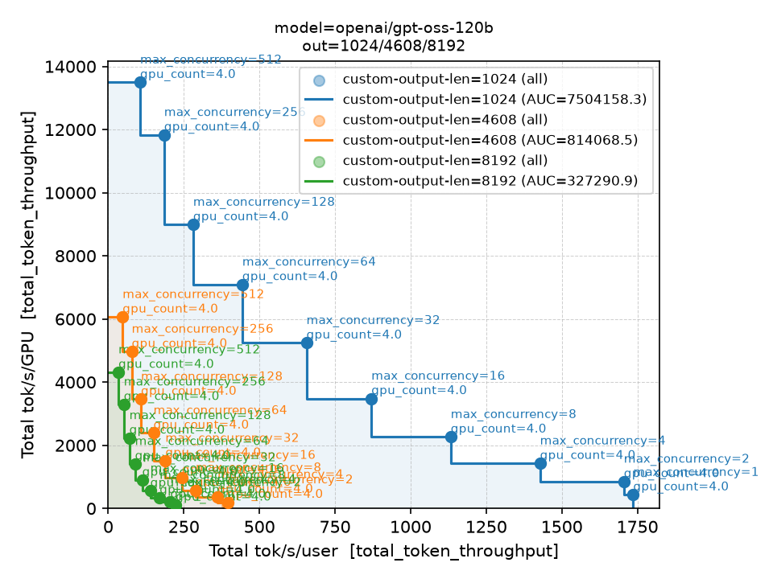

# LLM Inference Benchmark — Cross-Hardware Evaluation Suite

This document is the authoritative specification for the benchmark. It defines what is
measured, how to reproduce a result, which parameters are fixed, and how submissions are
scored. **Where this document is silent, the configuration is prohibited by default**; contact
the organisers before deviating from any stated requirement.

---

## Table of Contents

1. [Overview](#1-overview)
2. [Metric Definition](#2-metric-definition)
3. [Models & Precision Policy](#3-models--precision-policy)
4. [Workloads & Datasets](#4-workloads--datasets)
5. [Running the Benchmark](#5-running-the-benchmark)
6. [Submitting Results](#6-submitting-results)
7. [Scoring](#7-scoring)
8. [Rules](#8-rules)
9. [Edge-Case Rulings](#9-edge-case-rulings)
10. [Flag Reference](#10-flag-reference)

---

## 1. Overview

The benchmark measures **LLM serving throughput and interactivity** on a fixed software stack
(vLLM) across accelerator platforms. Model checkpoints, precision, datasets, and workload
parameters are fully specified; the only variable under evaluation is the hardware (and the
software ecosystem that drives it).

Production LLM inference occupies two operating regimes that trade off against each other —
larger batches raise throughput per GPU but lower throughput per user:

| Regime | Optimises for | Dominant bottleneck |
|--------|--------------|---------------------|
| **Online** (interactive) | Low latency per user | Memory bandwidth (decode-bound) |
| **Offline** (batch) | Aggregate throughput | Compute (prefill-bound) |

A benchmark fixed at one operating point can be tuned for that point alone. This benchmark
therefore sweeps the full concurrency range and scores the **area under the
throughput-per-GPU vs. throughput-per-user Pareto frontier**, capturing both regimes in a
single number. The metric increases monotonically with compute (FLOPS/GPU), memory capacity and
bandwidth per GPU, the number of GPUs in a high-bandwidth domain, and host/interconnect
performance.

---

## 2. Metric Definition

The primary measurement is `total_token_throughput`, as reported by `vllm bench serve`:

```
total_token_throughput = (Σ input_tokens + Σ output_tokens) / wall_clock_seconds
```

It is normalised to two axes for the Pareto plot:

| Axis | Formula | Interpretation |
|------|---------|----------------|
| **y — tok/s/GPU** | `total_token_throughput / (TP × PP)` | Hardware efficiency (offline regime) |
| **x — tok/s/user** | `total_token_throughput / max_concurrency` | Per-user interactivity (online regime) |

Each run produces one `(x, y)` point for a given `(model, workload shape, parallelism,
concurrency)`. Sweeping concurrency traces a curve from the high-interactivity corner (low
concurrency) to the high-efficiency corner (high concurrency).

---

## 3. Models & Precision Policy

Three models are evaluated, each contributing one-third of the final score:

| # | Model | Checkpoint | Precision | Architecture |
|---|-------|------------|-----------|--------------|
| 1 | **Llama 3.3 70B Instruct** | `nvidia/Llama-3.3-70B-Instruct-FP8` or `amd/Llama-3.3-70B-Instruct-FP8-KV` | FP8 W8A8 | Dense |
| 2 | **GPT-OSS-120B** | `openai/gpt-oss-120b` | MXFP4 (native) | MoE |
| 3 | **DeepSeek V4 Pro** | `deepseek-ai/DeepSeek-V4-Pro` | FP4+FP8 mixed (native) | MoE, 1.6T total / 49B active |

**Precision is fixed per model and may not be substituted.** The score contains no accuracy
term, so a free choice of precision would reward throughput gained by degrading output quality —
gaming the metric cannot detect. The three precisions are chosen for broad native hardware
support:

- **Llama 70B → FP8 (W8A8).** Natively supported on every current datacentre accelerator and
  effectively lossless relative to BF16. Two numerically equivalent builds are accepted:
  `nvidia/Llama-3.3-70B-Instruct-FP8` and `amd/Llama-3.3-70B-Instruct-FP8-KV` (its FP8 KV-cache
  scales are immaterial — the harness fixes `--kv-cache-dtype fp8` everywhere).
- **GPT-OSS-120B → MXFP4 native.** The released weights are stored in MXFP4; use the base
  `openai/gpt-oss-120b` checkpoint. Any other checkpoint such as the `amd/gpt-oss-120b-w-mxfp4-a-fp8` variant (adds FP4
  activation quantisation) is prohibited — see [§9](#9-edge-case-rulings).
- **DeepSeek V4 Pro → FP4+FP8 mixed native.** Trained with MoE expert weights in FP4 and
  attention/router/normalisation weights in FP8. FP4 encodings differ across vendors (block-16
  with FP8 scales vs block-32 with power-of-two scales), so a byte-identical checkpoint is not
  possible — each platform runs its own native FP4 build of the base weights.

### DeepSeek V4 Pro layout and FP4 accuracy gate

Every platform loads the base `deepseek-ai/DeepSeek-V4-Pro` checkpoint and uses tensor-,
pipeline-, and expert-parallelism ([§8.4](#84-parallelism)), sized to the model's
~1.6T-parameter footprint (≈16 GPUs). Lay it out to match the node's GPU count and memory: a
single node where enough high-bandwidth GPUs are available, otherwise across nodes (the Snellius
H100 reference serves it as **TP4 × PP4 across four 4-GPU nodes** via Ray).

---

## 4. Workloads & Datasets

### Datasets are fixed inputs — download, never regenerate

The benchmark datasets are vLLM `CustomDataset` JSONL files, one set per model. **Download them
from the organisers:**

> **https://surfdrive.surf.nl/s/MjZ7zQ2ZrZY7nnX**

They **must not be regenerated, reshuffled, truncated, re-tokenised, or substituted.** They are
deterministic random-token corpora (seed `0`, `--range-ratio 0`), so every prompt has an exact
token count; each model's files use that model's own tokeniser, so token lengths are not portable
across models. The harness points each model at its matching files — cross-assigning them is
invalid.

Place the files under `datasets/`. The harness copies each one to **`/dev/shm`** before serving
(local RAM disk, so every worker reads it at memory speed); the bench configs reference the
`/dev/shm/...` path. The `n1024` / `n32768` / `n131072` filename suffix is the **prompt count** —
**the same dataset at different sizes** (the larger files extend the smaller ones, so they are
consistent). Each run needs at least `num_prompts = 2 × max_concurrency` prompts, so pick a size
that covers your largest concurrency: `n1024` suffices up to `max_concurrency = 512`; extending the
sweep beyond that ([§4 concurrency](#concurrency-sweep)) requires the larger files.

### Workload shapes

The context window is fixed at **`--max-model-len = 9216`** (8192 + 1024). Three shapes test
distinct regimes:

| Shape | Input tokens | Output tokens | Primary stress |
|-------|:------------:|:-------------:|----------------|
| `i8192_o1024` | 8192 | 1024 | Prefill — FLOPS-bound |
| `i1024_o8192` | 1024 | 8192 | Decode — memory-bandwidth-bound |
| `i4608_o4608` | 4608 | 4608 | Balanced |

### Concurrency sweep

`max_concurrency` (client) and `max_num_seqs` (server) are swept jointly. **Values must be
powers of two.** The required baseline is `{1, 2, 4, …, 512}`. Vendors **may extend the upper
bound** with additional powers of two (`1024, 2048, …`) to enlarge the search space — useful for
hardware that sustains higher concurrency before running out of KV-cache memory. Vendors **may
not** use any non-power-of-two value, and may not drop values below the baseline ceiling reached
before OOM. To extend the sweep, edit `CONCURRENCY` in
[`scripts/gen_configs.py`](scripts/gen_configs.py) and regenerate (see [§5](#5-running-the-benchmark)).

The scored configuration space per submission is:

```
3 models  ×  3 workload shapes  ×  {prescribed parallelism}  ×  {powers-of-two concurrency}
```

---

## 5. Running the Benchmark

### 5.1 System requirements

| Requirement | Detail |
|-------------|--------|
| Job scheduler | **SLURM (required).** One worker job per `(serve, bench)` pair; multi-node serves use `srun` + Ray. The orchestrator may run as a submitted job or locally with `--local` (see §5.5). |
| Container runtime | Apptainer / Singularity, or Podman. Workers run exclusively inside the official image. |
| Official base image | Any official vLLM image from [`hub.docker.com/r/vllm/`](https://hub.docker.com/r/vllm/) — e.g. `vllm/vllm-openai` (CUDA) or `vllm/vllm-openai-rocm` (ROCm) — at the pinned version. Images from any other source are not permitted ([§8.5](#85-prohibited)). |
| Accelerators | NVIDIA or AMD. Single-node and multi-node (NVIDIA validated; AMD single-node validated, multi-node AMD — see §5.4). |
| Host Python | ≥ 3.11 (orchestrator only — runs on the host for SLURM access). |
| Model cache | A shared `HF_HOME` visible from all nodes. Download weights once before the run. |
| Datasets | `datasets/*.jsonl` from the organisers ([§4](#4-workloads--datasets)). |

The pinned vLLM version is `VLLM_VERSION` in
[`containers/build_vllm_bench.slurm`](containers/build_vllm_bench.slurm) — currently **`v0.23.0`**.
Every submission must use this version; a mismatch invalidates the submission. The pin is chosen as
the newest version that supports the full target-hardware matrix (FP4 / DeepSeek-V4 kernel support
varies by vendor and version). Bumping it is a global decision by the organisers that invalidates
prior submissions — do not change it unilaterally.

### 5.2 Building the container

The image adds only what the harness requires: the benchmark client (`vllm[bench]`) and the
multi-node serving transport (`ray[cgraph]` + its matching CuPy build, for cross-node collectives
when serving DeepSeek-V4-Pro across nodes). No model-execution packages — alternative kernels,
attention libraries, or quantisation backends — may be added.

```bash
sbatch containers/build_vllm_bench.slurm                          # NVIDIA (default)
GPU_VENDOR=amd sbatch containers/build_vllm_bench.slurm           # AMD (ROCm)
BUILDER=podman GPU_VENDOR=amd sbatch containers/build_vllm_bench.slurm   # Podman builder
```

Output: `containers/vllm-bench_<vendor>_<version>.sif` (or `.tar` for Podman). Point the
`containers/latest.sif` symlink at the new image.

### 5.3 Downloading model weights

```bash
export HF_HOME=/path/to/shared/model-cache   # must be readable on every compute node

huggingface-cli download nvidia/Llama-3.3-70B-Instruct-FP8  # or https://huggingface.co/amd/Llama-3.3-70B-Instruct-FP8-KV
huggingface-cli download openai/gpt-oss-120b
huggingface-cli download deepseek-ai/DeepSeek-V4-Pro
```

### 5.4 Platform configuration

Per-cluster settings live in `configs/<cluster>/system.sh`. Copy the reference
[`configs/snellius/h100/system.sh`](configs/snellius/h100/system.sh) and adjust for your platform
(on ROCm, use `--rocm` in `CONTAINER_EXEC` and your fabric NIC in `NCCL_SOCKET_IFNAME`):

| Variable | Meaning / Snellius H100 reference |
|----------|-----------------------------------|
| `GPUS_PER_NODE` | GPUs per node (`4`); serve configs needing more span nodes via Ray |
| `SBATCH_ARGS` | `-p gpu_h100` (your GPU partition / account / QOS) |
| `GPU_REQUEST_TMPL` | GPU-per-node request; `{n}` = per-node count. Default `--gpus-per-node={n}`; use `--gres=gpu:{n}` for gres-based schedulers |
| `HF_HOME` | shared model cache, readable from every node |
| `CONTAINER_EXEC` | `apptainer exec --nv --bind /path/to/shared …latest.sif` (NVIDIA) / `--rocm …` (AMD) |

Container-runtime flags and any system-level environment required for correct operation (NIC
selection on a multi-node fabric, `HSA_*` / RCCL tuning on ROCm, etc.) are platform-specific and
**permitted** — see [§8.3](#83-tunable-parameters); document any such change in your submission
([§6](#6-submitting-results)). The structure of `system.sh` is identical everywhere.

**Multi-node AMD.** The multi-node path (Ray over the allocation) is vendor-agnostic — RCCL honours
the `NCCL_*` env vars and the container runs the official ROCm image unmodified. On ROCm the
CUDA-only compiled-graph transport (CuPy) is skipped and Ray falls back to RCCL collectives; if a
multi-node ROCm serve fails to bring up, set `VLLM_USE_RAY_COMPILED_DAG=0` in your `system.sh`.
Validate multi-node AMD on your hardware; if it cannot run due to a bug in this harness, see
[§5.6](#56-when-a-run-fails).

The serve- and bench-parameter JSON files are the **scored configuration** and are authored by the
canonical generator [`scripts/gen_configs.py`](scripts/gen_configs.py). Do not edit them except
where [§8](#8-rules) explicitly permits; see [`configs/README.md`](configs/README.md) for the
config layout.

### 5.5 Launching a sweep

One command sweeps every model for a cluster, then plots and scores:

```bash
./run.sh snellius/h100              # submit the orchestrator as a SLURM job
./run.sh snellius/h100 --local      # run the orchestrator in this shell (login/interactive node)
./run.sh snellius/h100 --dry-run    # preview worker allocations; submits nothing, needs no GPUs
```

The orchestrator is a lightweight coordinator (it only `sbatch`es and polls workers), so it can run
either as a submitted job (default) or directly in your shell with `--local` — handy on a login or
interactive node outside an allocation. The GPU **workers** are always SLURM jobs.

`<cluster>` selects `configs/<cluster>/`. Override `HF_HOME`, `SBATCH_ARGS`, `CONTAINER_EXEC`,
etc. via the environment. [`run.sh`](run.sh) submits the orchestrator
[`scripts/vllm_sweep_parallel.sh`](scripts/vllm_sweep_parallel.sh), which runs
[`src/sweep_parallel.py`](src/sweep_parallel.py) to:

1. Merge each model's serve/bench params and cross-join them by `--link-vars`
   (`max_num_seqs=max_concurrency, model=model`).
2. Submit one worker **per serve config**, carrying its matched bench shapes; GPUs per job =
   `TP × PP`. A config needing more GPUs than one node holds is served across nodes via a Ray
   cluster the worker starts with `srun` (this is how DeepSeek-V4-Pro spans 4 nodes on H100).
3. Each worker copies its datasets to `/dev/shm`, starts `vllm serve` once, runs all its bench
   shapes sequentially, and writes `summary.json`.
4. Poll SLURM until all workers finish, then generate the Pareto plots and score files.

A worker whose engine dies or wedges (e.g. an out-of-memory crash at high concurrency) aborts
itself promptly and releases its nodes — it does **not** hang to walltime — and the shapes that did
complete keep their results. Such a configuration simply contributes fewer points to the frontier.

### 5.6 When a run fails

If the suite does not run on your platform, there are two sanctioned paths — never silently work
around the harness:

1. **Your system needs different settings.** You may change **system/operational** flags to make it
   run — interconnect/NIC selection (`NCCL_SOCKET_IFNAME`), `HSA_*` / RCCL env, container-runtime
   flags, cache locations, timeouts, the Ray transport knob (`VLLM_USE_RAY_COMPILED_DAG`), etc.
   These are permitted ([§8.3](#83-tunable-parameters)) — they affect operability, not the
   numerical result. **Document every such change in your submission** ([§6](#6-submitting-results)).
   You may **not** change any fixed parameter ([§8.1](#81-fixed-parameters)) to work around a failure.

2. **The harness or spec itself is broken** (a bug in this code, not your system). Do not patch
   around it. Escalate so it is fixed centrally and all parties run the same corrected code:
   contact **EuroHPC**, who coordinates with the benchmark maintainers to fix the repository.

---

## 6. Submitting Results

The deliverable is **`scores.csv`** — the file `run.sh` writes at the end of a sweep. It is
self-describing: one row per subtask with `model, input_len, output_len, auc, n_points,
n_frontier`, so it conveys exactly which models and shapes were run and their scores. A complete
submission covers all three models × three shapes.

Submit, alongside `scores.csv`:
- A **deviations note** — any system/operational flag you changed to make the suite run on your
  platform ([§5.6](#56-when-a-run-fails)); "none" if unchanged.
- The **container image** identity (vendor + pinned version) and confirmation that **no fixed
  parameter ([§8.1](#81-fixed-parameters)) was overridden**.

Optional supporting evidence (kept under `results/<timestamp>/` for audit, not required for
scoring): `scores.json`, the `pareto/PARETO-*.png` plots, the per-config `summary.json` files, and
the `slurm/worker_*` logs. Re-plot or re-score an existing run without re-benchmarking:

```bash
RESULTS=results/<timestamp>
EXEC="apptainer exec --nv --bind /path/to/shared containers/latest.sif"   # --rocm on AMD
$EXEC python3 src/utils/plot_pareto.py "$RESULTS" --fig-by=model --curve-by=custom-output-len
$EXEC python3 src/utils/score.py "$RESULTS"
```

---

## 7. Scoring

The final score is in **(0, 1]**, where **1.0** is the best result observed across all
submissions for a given component.

### Step 1 — Pareto AUC per (model, shape)

For each `(model, shape)`, all swept `(x, y)` points are collected, the **Pareto frontier**
(upper-right envelope: points not dominated on both axes) is extracted, and the **area under the
staircase frontier** from `x = 0` is computed:

```
AUC = Σᵢ (xᵢ − xᵢ₋₁) · yᵢ      [frontier points sorted by x ascending]
```

A high AUC requires strong performance at **both** ends of the curve — high per-user
interactivity *and* high per-GPU efficiency — so a submission tuned for one regime cannot score
well. This is implemented in [`src/utils/plot_pareto.py`](src/utils/plot_pareto.py);
[`src/utils/score.py`](src/utils/score.py) emits the per-`(model, shape)` AUC to `scores.csv` /
`scores.json`.

**Example — GPT-OSS-120B, Snellius H100:**



Each curve is one workload shape; markers are the swept concurrency points (`{1…512}` here) and the
staircase is the Pareto frontier whose area is the AUC. The corresponding `scores.csv` rows:

| model | input_len | output_len | auc |
|-------|:---------:|:----------:|----:|
| openai/gpt-oss-120b | 8192 | 1024 | 7,504,158 |
| openai/gpt-oss-120b | 4608 | 4608 | 814,069 |
| openai/gpt-oss-120b | 1024 | 8192 | 327,291 |

### Step 2 — Normalisation across submissions

For each `(model, shape)`, each submission's AUC is divided by the best AUC achieved on that same
`(model, shape)`:

```
norm(party, model, shape) = AUC(party, model, shape) / max_p AUC(p, model, shape)   ∈ (0, 1]
```

Only like-for-like curves are compared.

### Step 3 — Aggregation

```
model_score(party, model) = mean_shape  norm(party, model, shape)
final_score(party)        = (1/3) · Σ_model  model_score(party, model)
```

Each model contributes one-third; within a model, each shape contributes equally. Steps 2–3 are
performed by the organisers across all submissions — the flat `scores.csv` schema is designed to
be concatenated across runs for exactly this.

---

## 8. Rules

Every parameter is **Fixed**, **Operational**, **Tunable**, or **Prohibited**:

| | Category | Meaning |
|:-:|---------|---------|
| 🔒 | **Fixed** | Enforced by the harness; identical on all platforms. Overriding it invalidates the submission. |
| ⚙️ | **Operational** | Harness mechanics (I/O, process layout, timeouts). Not a scoring lever; affects neither the numerical output nor the comparison. |
| ✅ | **Tunable** | Set freely per platform. Affects only *how fast* the same computation runs — not the result. Asymmetry between platforms is expected and fair. |
| ⛔ | **Prohibited** | Must not be used. Breaks comparability, introduces numerical asymmetry, or violates the container requirement. |

**Governing principle:** model weights, numerical precision, KV-cache precision, and workload
shape must be identical across platforms. Every choice that affects only *how quickly* the same
computation executes — kernel selection, memory layout, fusion, communication backend, system
tuning — is tunable.

### 8.1 Fixed parameters

Set by the harness ([`scripts/vllm_sweep_parallel.sh`](scripts/vllm_sweep_parallel.sh)); must not
be overridden:

| Parameter | Required value | Rationale |
|-----------|---------------|-----------|
| Model checkpoint | Per [§3](#3-models--precision-policy) | A different checkpoint is a different model. |
| Weight precision | FP8 / MXFP4 / native FP4+FP8 | No accuracy term in the score; free precision would reward quality loss. |
| `--kv-cache-dtype` | `fp8` | FP8 KV cache trades accuracy for capacity; fixed symmetrically. |
| `--max-model-len` | `9216` | All datasets fit within this budget. |
| `--max-num-batched-tokens` | `9216` | Any full-length prompt prefills in one pass; equal scheduling across platforms. |
| `--enable-chunked-prefill` | enabled | Identical scheduling behaviour. |
| `--no-enable-prefix-caching` | caching off | Prefix-cache hits would skip computation and inflate throughput. |
| `--skip-chat-template` | enabled | Raw-token prompts; no chat formatting. |
| `--request-rate` | `inf` | Open-loop: the concurrency ceiling governs load, not an arrival rate. |
| `--ignore-eos` | enabled | Forces generation to the prescribed output length. |
| `--percentile-metrics` | `ttft,tpot,itl,e2el` | Uniform recorded metric set. |
| `max_concurrency` / `max_num_seqs` | powers of two; baseline `{1…512}` | Defines the swept curve and the per-user normaliser. Upper bound extensible ([§4](#4-workloads--datasets)). |
| Dataset files | `datasets/*.jsonl` | Frozen inputs ([§4](#4-workloads--datasets)). |

### 8.2 Operational parameters

Harness mechanics — set uniformly by the harness, **not scoring levers**. Do not change them;
they do not affect the numerical result or the comparison:

`--download-dir`, `--safetensors-load-strategy`, `--api-server-count`, `--backend=vllm`,
`--dataset-name=custom`, `--save-result`, `--ready-check-timeout-sec`, `--num-prompts` (set to
`2 × max_concurrency`), and the DeepSeek-V4 load requirements `--trust-remote-code` /
`--tokenizer-mode`.

### 8.3 Tunable parameters

Each selects *how* the computation runs without changing *what* is computed. Use your platform's
optimal implementation — asymmetry is **expected and fair**, as it reflects the software ecosystem
being evaluated alongside the hardware.

| Domain | What is tunable | Basis for fairness |
|--------|-----------------|--------------------|
| Attention backend | The platform's optimal attention kernel. | Same attention, different kernel — mathematically equivalent. |
| Graph capture & compilation (`-cc.mode`, `cudagraph_mode`, torch.compile / inductor) | Capture mode and fusion strategy. | Fusion does not alter results (within float rounding). |
| MoE & linear kernels (`--moe-backend`, `--linear-backend`) | The platform's optimal GEMM/MoE kernels. | Kernel selection on identical weights. |
| KV-cache memory layout (`--block-size`) | Block size and cache layout. | Memory layout only. |
| Collective / all-to-all backend (MoE) | The platform's native collective-communication kernels. | Kernel/transport selection — same class as `--moe-backend` / `-cc.mode`. |
| `--gpu-memory-utilization` | Fraction of VRAM vLLM may use. | Different GPU memory sizes warrant different values to maximise KV cache without OOM. |
| **System / operational environment** | Settings required for correct operation: network-interface selection (e.g. `NCCL_SOCKET_IFNAME`), interconnect env, container-runtime flags, engine/ready timeouts. | Tuning software side of the ecosystem for correct performance on the target system. |

> The Snellius H100 reference sets `-cc.mode=3 -cc.cudagraph_mode=FULL_DECODE_ONLY` for
> DeepSeek-V4-Pro (its default compilation does not serve on the TP4×PP4 layout). This is a
> per-platform compilation choice, so it lives in that model's config, not the shared harness
> command.

### 8.4 Parallelism

The parallelism **layout is tunable**: each vendor sizes it to their hardware (GPU count and memory
per GPU). `TP × PP` is the tok/s/GPU denominator, so additional GPUs are rewarded only through the
larger KV cache and lower per-GPU FLOPS they provide. The shipped `serve-params.json` carry the
Snellius H100 reference's choices; adjust them for your platform.

| Parameter | Rule |
|-----------|------|
| `--tensor-parallel-size` | Tunable — choose per your hardware. Counts toward the `TP × PP` denominator. |
| `--pipeline-parallel-size` | Tunable — combine with TP to fit the model across your GPUs/nodes. Counts toward the denominator. |
| `--enable-expert-parallel` | Tunable; typically required for the MoE models. Must work within the official container. |
| `--data-parallel-size` | Outside the swept configuration — GPU scaling uses TP and PP only, kept this way to bound the search space. |

### 8.5 Prohibited

| Parameter / method | Reason |
|--------------------|--------|
| A base image not from the official [`hub.docker.com/r/vllm/`](https://hub.docker.com/r/vllm/) org, or installing any model-execution package beyond the harness image's own deps | Reproducibility requires an official vLLM image at the pinned version. |
| Alternative checkpoint or precision for any model | A different checkpoint/precision is a different model. Includes `amd/gpt-oss-120b-w-mxfp4-a-fp8` and any FP4 Llama variant. |
| Modifying or regenerating dataset files | Frozen inputs ([§4](#4-workloads--datasets)). |
| `--enable-prefix-caching` | Skips computation on repeated prefixes; inflates throughput. |
| `--speculative-config` (EAGLE, MTP, n-gram) | Acceptance rates are hardware-speed-dependent, making token throughput non-comparable. |
| `--performance-mode` | Opaque meta-flag that sets different parameters per platform; not auditable. |
| Additional weight or activation quantisation | Equivalent to running a different precision. |

---

## 9. Edge-Case Rulings

The principle of [§8](#8-rules) governs: a change affecting only execution speed is tunable; one
altering the computation or workload shape is prohibited.

1. **Lower-precision weights for a fixed-precision model** — prohibited (precision is fixed to
   prevent undetectable quality loss).
2. **Prefix caching on the random-token datasets** — prohibited regardless of shared prefixes;
   the parameter is fixed off.
3. **Truncating output to inflate throughput** — impossible; `--ignore-eos` forces generation to
   `custom-output-len`.
4. **Speculative decoding** — prohibited; see [§8.5](#85-prohibited).
5. **Installing extra packages or custom kernels** — prohibited; only what ships in the official
   image at the pinned version may be used.
6. **Optimising for a single concurrency value** — the score is the area under the whole frontier;
   one point cannot disproportionately inflate the AUC.
7. **A different vLLM version than the pinned one** — invalid; all submissions use the same version.

Configurations not addressed here are **prohibited by default**. Contact the organisers before
proceeding with anything not explicitly sanctioned.

---

## 10. Flag Reference

Condensed classification of all evaluated parameters. This document governs in all cases.

| Parameter | Category | Notes |
|-----------|:--------:|-------|
| Model checkpoint / weight precision | 🔒 | Fixed per model ([§3](#3-models--precision-policy)). |
| `--kv-cache-dtype fp8` | 🔒 | Fixed; symmetric across platforms. |
| `--max-model-len`, `--max-num-batched-tokens` | 🔒 | Fixed at `9216`. |
| `--enable-chunked-prefill`, `--no-enable-prefix-caching` | 🔒 | Fixed. |
| `--skip-chat-template`, `--request-rate inf`, `--ignore-eos`, `--percentile-metrics` | 🔒 | Fixed bench parameters. |
| `max_concurrency` / `max_num_seqs` | 🔒 | Powers of two; baseline `{1…512}`, upper bound extensible. |
| `--download-dir`, `--safetensors-load-strategy`, `--api-server-count` | ⚙️ | Operational; harness mechanics. |
| `--backend`, `--dataset-name`, `--save-result`, `--ready-check-timeout-sec`, `--num-prompts` | ⚙️ | Operational bench mechanics. |
| `--trust-remote-code` / `--tokenizer-mode` (DeepSeek-V4) | ⚙️ | Operational model-load requirements. |
| `--tensor-parallel-size`, `--pipeline-parallel-size` | ✅ | Vendor sizes the layout to their hardware; counts toward the `TP × PP` denominator. |
| `--gpu-memory-utilization` | ✅ | Fraction of VRAM; tune per GPU memory size. |
| Attention backend | ✅ | Vendor-optimal kernel; mathematically equivalent. |
| `-cc.mode`, `cudagraph_mode`, torch.compile / inductor | ✅ | Kernel fusion / capture; no change to results. |
| `--moe-backend`, `--linear-backend`, collective / all-to-all backend | ✅ | Kernel/transport selection on identical weights. |
| `--block-size` | ✅ | Memory layout only. |
| `--enable-expert-parallel` | ✅ | Tunable; identical both sides; official image only. |
| System / network environment (`NCCL_SOCKET_IFNAME`, runtime flags, …) | ✅ | Required for correct operation; affects speed, not results. |
| `--data-parallel-size` | — | Outside the swept configuration (scale with TP/PP). |
| `--speculative-config` | ⛔ | Hardware-speed-dependent acceptance rate. |
| `--performance-mode` | ⛔ | Sets different parameters per platform; not auditable. |
